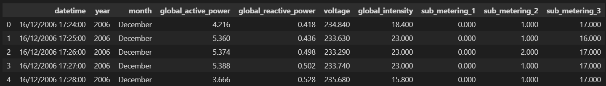

When working with data, we often think about data types in terms of correctness: numbers should be represented as numbers, dates as dates, and booleans as `True` or `False`. However, data types also affect memory consumption. Two columns can contain the same values and represent the same information while requiring different amounts of memory because of how they are represented. This difference may seem insignificant in small datasets, but as data volumes grow, these "minor" decisions can have implications for performance, scalability, and infrastructure costs.

## What Is a Data Type?
A data type defines how data is represented and interpreted by a computer. Choosing an appropriate type should reflect the nature of the variable and the meaning of the information it carries. Basically, variables can be classified into three classes:
- **Categorical:** Represent groups or labels, such as product categories, customer segments, or country codes. They can be _nominal_ (without a natural order, such as country names) or _ordinal_ (with a meaningful order, such as low, medium, and high).
- **Numerical:** Represent quantities and can be _discrete_ (e.g., number of items sold) or _continuous (e.g., temperature ,weight).
- **Datetime:** Represent dates and times in a structured format that supports temporal operations, such as calculating durations, comparing dates, and extracting time components.

The challenge is that the way data is represented does not always reflect its nature. A date (e.g., `2026-10-08`) might be stored as a string, while a categorical identifier (e.g., the product code `00123456789`) might be stored as an integer simply because it contains digits. These representations can obscure the meaning of the data, introduce unnecessary conversions, or make operations less intuitive. Choosing appropriate data types helps preserve semantics, maintain data quality, and enable systems to process values more effectively.


## Same Data, Different Types, Less Memory Usage
Consider the [*Individual Household Electric Power Consumption*](https://archive.ics.uci.edu/dataset/235/individual+household+electric+power+consumption) dataset, which contains measurements of electric power consumption in one household with a one-minute sampling rate over a period of almost 4 years. When loaded into [Python](https://www.python.org) (through [Pandas](https://pandas.pydata.org) library), all columns are stored as strings, even when they represent dates or numerical values. The data may look correct, but these representations might not be suitable for the information they carry or the operations we want to perform.

<aside class="notebook-callout">
  <p>Want to explore the full analysis? <a href="https://github.com/nmhahn/nmhahn.github.io/blob/main/assets/posts/2026-10-19-data-types/datatype_example.ipynb"><br>View the full Jupyter notebook on GitHub</a>.</p>
</aside>

> **Disclaimer**: In order to ease the illustration and manipulation I did a few preprocessings:
> - Converted all column names to lowercase.
> - Combined `date` and `time` into a single `datetime` column.
> - Created separate `year` and `month` columns.

```python
import pandas as pd
df = pd.read_table(
	"household_power_consumption.txt", 
	sep=";", 
	decimal=",", 
	low_memory=False
)

# Preprocessings
# ...

df.head()
```



The initial dataset occupies **1,100.46 MB of memory**, with most columns consuming more than 100 MB each. This illustrates how the choice of data type representation can affect memory consumption, even when the underlying information is unchanged:

| **Column Name**       | **Data Type** | **Memory Usage** |
|:----------------------|:--------------|-----------------:|
| datetime              | string        | 134.58 MB        |
| year                  | string        | 104.89 MB        |
| month                 | string        | 109.10 MB        |
| global_active_power   | string        | 106.77 MB        |
| global_reactive_power | string        | 106.77 MB        |
| voltage               | string        | 110.68 MB        |
| global_intensity      | string        | 106.99 MB        |
| sub_metering_1        | string        | 106.83 MB        |
| sub_metering_2        | string        | 106.83 MB        |
| sub_metering_3        | string        | 107.00 MB        |


**The key is to match the representation to the nature of the data.** Dates should use datetime types, numerical measurements should use appropriate numeric types, and categorical variables may benefit from categorical representations when their characteristics make them suitable. The goal is not simply to choose the smallest possible type, but to properly represent data without consuming extra resources. In this example, we've achieved this by converting each column to a more suitable type, i.e.,:
- `datetime` to a datetime type;
- `year` to an integer type;
- `month` to a categorical type;
- electrical measurements to float type.

```python
df["datetime"] = pd.to_datetime(df["datetime"], format="%d/%m/%Y %H:%M:%S")
df["year"] = df["year"].astype("int")
df["month"] = df["month"].astype("category")

# I've replaced the dummy value "?" used to fill missing values 
df["global_active_power"] = df["global_active_power"].astype("float")
df["global_reactive_power"] = df["global_reactive_power"].astype("float")
df["voltage"] = df["voltage"].astype("float")
df["global_intensity"] = df["global_intensity"].astype("float")
df["sub_metering_1"] = df["sub_metering_1"].astype("float")
df["sub_metering_2"] = df["sub_metering_2"].astype("float")
df["sub_metering_3"] = df["sub_metering_3"].astype("float")
```

After converting the columns, the dataset's memory usage drops to **144.48 MB**. Most columns now consume less than 16 MB each, while the categorical `month` column requires only 1.98 MB.

| **Column Name**       | **Data Type** | **Memory Usage** |
|:----------------------|:--------------|-----------------:|
| datetime              | datetime      | 15.83 MB         |
| year                  | integer       | 15.83 MB         |
| month                 | category      | 1.98 MB          |
| global_active_power   | float         | 15.83 MB         |
| global_reactive_power | float         | 15.83 MB         |
| voltage               | float         | 15.83 MB         |
| global_intensity      | float         | 15.83 MB         |
| sub_metering_1        | float         | 15.83 MB         |
| sub_metering_2        | float         | 15.83 MB         |
| sub_metering_3        | float         | 15.83 MB         |

This represents a reduction of **~87% in memory usage**, without removing rows or columns. The improvement comes from "only" representing the information properly, rather than storing every value as text.

The exact results depend on the dataset, its original representations, and the types selected. Conversions must preserve the meaning of the data and handle missing or invalid values. Memory savings also do not automatically guarantee faster execution or lower infrastructure costs. However, this experiment demonstrates how a "minor" implementation decision can have a substantial effect on resource consumption, and why choosing appropriate data types matters.


## From Memory Optimization to System-Level Impact
In real-world data systems, data passes through multiple stages, where it may be loaded into memory, copied, cached, or processed by multiple workers. Although saving memory in a single dataset might not seem particularly important, inefficient representations can increase memory consumption across workloads, affecting processing efficiency, scalability, and infrastructure costs. Therefore, choosing appropriate data types can reduce memory usage and, depending on the workload, minimize conversion overhead and improve processing efficiency. At scale, these improvements may help prevent out-of-memory failures and avoid unnecessary infrastructure costs.

Choosing appropriate data types helps preserve correctness while reducing unnecessary resource consumption. For data engineers and engineering leaders, evaluating both the accuracy of pipeline outputs and the efficiency of data processing is essential. **Data representation is an engineering decision** that influences the scalability and efficiency of growing data systems.
  

## Wrapping Up
Data types influence memory consumption and can affect processing efficiency, scalability, and infrastructure costs, depending on the workload. **Choosing representations that reflect the nature of the data and the requirements of the workload** helps build more efficient and reliable data systems.

While individual decisions may seem minor, their effects can accumulate across large datasets and recurring pipelines. Understanding how data is represented and processed helps identify opportunities to improve resource utilization without compromising correctness.

**How do you approach data representation in your projects?** Have you experienced improvements in memory consumption or pipeline performance by choosing more appropriate data types? Share your experience in the comments!

If you enjoy discussing data engineering, data science, analytics, and AI-driven data systems, feel free to connect with me on [LinkedIn](https://www.linkedin.com/in/nmhahn/).